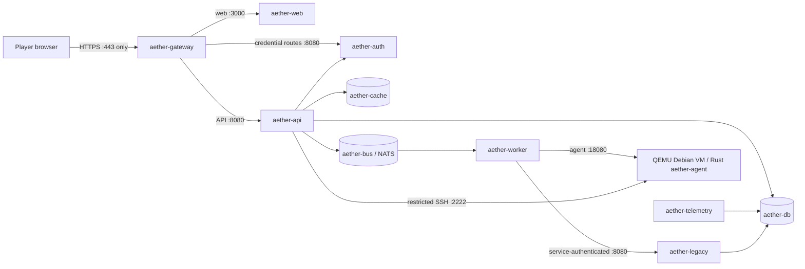

# BLACK VEIL network boundaries

## Running topology

## Firewall policy

| Source | Destination | Allowed traffic |
|---|---|---|
| Player network | Gateway | TCP 443 |
| Gateway | Web | TCP 3000 |
| Gateway | API | TCP 8080 |
| Gateway | Auth | TCP 8080, credential routes only |
| API | Auth | TCP 8080, private session resolution |
| API / auth / worker / telemetry / legacy | PostgreSQL | TCP 5432 on private `data` network |
| API / auth / worker | Redis | TCP 6379 on private `data` network |
| API / auth / worker | NATS | TCP 4222 on private `data` network |
| Worker | Legacy service | TCP 8080 on private `data` network |
| Worker | Linux VM agent | TCP 18080 on private `lab` network only |
| API | Linux VM operator SSH | TCP 2222 on private `lab` network only; initiated after a `system_admin` session check |
| Player network | Any internal service | Denied |
| Challenge workloads | Organizer validator | Not implemented; no validator route is present |

Only the gateway is published on the host. Database, cache, bus, API, worker,
telemetry, auth, legacy and VM services have no host port mappings. Compose
internal networks are checked by `scripts/check-network.sh`. The internal `lab`
network joins only the API, worker and QEMU VM service; the gateway and web
frontend are excluded. QEMU user-mode NAT lets the guest reach API and worker
peers on the internal `lab` network; that network has no public egress.
Only guest SSH and agent ports are forwarded to the VM container, and neither
port is host-published. The API mounts the named guest-state volume read-only;
filesystem permissions expose only the restricted operator key to its
unprivileged service account. The guest SSH key is never sent to the browser.

## Deployment limitation

The local name `aether.blackveil.test` resolves to loopback on the player's host.
The setup script documents the required hosts entry and generates a local TLS
certificate. Production deployment must replace the local certificate and keep
the same single-entry-point policy. The isolated organizer validator is a future
phase and is not included in the current Compose stack.
