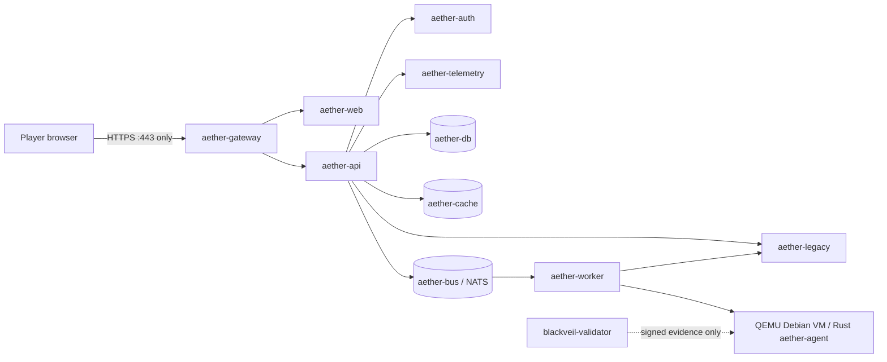

# BLACK VEIL network boundaries

## Planned topology

## Firewall policy

| Source | Destination | Allowed traffic |
|---|---|---|
| Player network | Gateway | TCP 443 |
| Gateway | Web | TCP 3000 |
| Gateway | API | TCP 8080 |
| API | Auth | TCP 8081 |
| API | Legacy | TCP 8082 |
| API | Telemetry | TCP 8083 |
| API / worker | PostgreSQL | TCP 5432 |
| API / worker | Redis | TCP 6379 |
| API / worker | NATS | TCP 4222 |
| API / worker | Linux VM agent | TCP 18080 on private `lab` network only |
| Player network | Any internal service | Denied |
| Challenge workloads | Validator | Denied; evidence is submitted through a constrained one-way interface |

Only the gateway is published on the host. Database, cache, bus, API, worker,
telemetry, auth, legacy and VM services have no host port mappings. Compose
internal networks are checked by `scripts/check-network.sh`. The internal `lab`
network joins only the API, worker and QEMU VM service; the gateway and web
frontend are excluded. QEMU user-mode NAT lets the guest reach only the API and
worker peers on the internal `lab` network; that network has no public egress.
Only guest SSH and agent ports are forwarded to the VM container, and neither
port is host-published.

## Deployment limitation

The local name `aether.blackveil.test` resolves to loopback on the player's host.
The setup script will document the required hosts entry and generate a local TLS
certificate. Production deployment must replace the local certificate and keep
the same single-entry-point policy.
